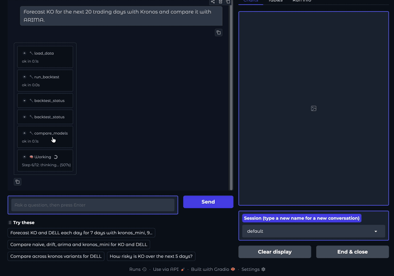
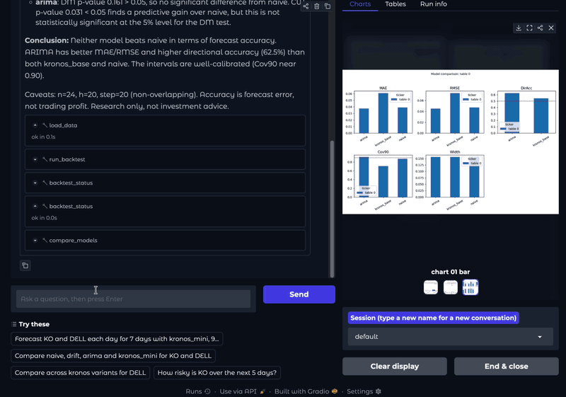
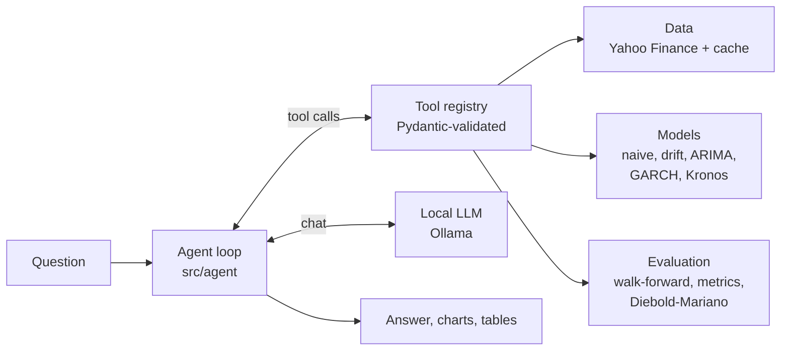

# Local Quant Research Agent

A quantitative research assistant that runs entirely on your own machine. You ask a question in plain English, a local LLM (served by [Ollama](https://ollama.com)) plans the analysis, calls validated forecasting and statistics tools, and answers with numbers taken only from those tools, plus charts and tables.

It covers daily stock return forecasting with classical baselines, ARIMA, GARCH volatility and the [Kronos](https://github.com/shiyu-coder/Kronos) time-series foundation model, evaluated with walk-forward backtests and Diebold-Mariano tests.



<sub>Forecast and model comparison for KO. Recorded on a laptop with a local model; sped up 10x, last part 2x.</sub>

## What it can do

- **Forecast** daily returns or a dated price path for a ticker, with prediction intervals, using naive, drift, ARIMA or Kronos (mini, small, base).
- **Compare models** with a rolling-origin backtest: MAE, RMSE, directional accuracy, interval coverage and width, and a Diebold-Mariano test against the naive benchmark.
- **Analyse risk** with GARCH-family volatility models (GARCH, ARCH, EGARCH; normal, t, skew-t, GED errors) and volatility-based intervals.
- **Tune** ARIMA orders and Kronos settings on a validation split, never on the test split.
- **Report** results as Markdown with charts and tables, from a chat UI or the command line.



<sub>GARCH volatility analysis for KO. Sped up 10x, last part 2x.</sub>

## How it works



- **Agent layer** (`src/agent/`): the loop plans with the LLM, runs tools with timeouts, trims history, checks that numbers in the answer are grounded in tool outputs, and forces a final summary when the step budget runs out. Task-specific instructions ("skills") live in `src/agent/skills/`.
- **Tool layer** (`src/tools/`): a single `call(name, **kwargs)` entry point. Every tool has a Pydantic schema, so bad arguments from the model are rejected with a clear error instead of failing silently. Results are cached as artifacts and referred to by ID.
- **Models** (`src/models/`), **evaluation** (`src/evaluation/`) and **reports** (`src/report/`) are plain Python modules that also work without the agent.

More detail: [architecture](docs/architecture.md), [tools](docs/tools.md), [evaluation](docs/evaluation.md).

## Evaluation discipline

Forecasting results are easy to overstate, so the project is strict about how models are judged:

- **No look-ahead.** Backtests use rolling origins; each forecast sees only data up to its origin, and targets lie strictly after it.
- **Out-of-sample error decides.** Selection is on out-of-sample RMSE against the naive benchmark; AIC and BIC are only used for screening.
- **Significance, not just ranking.** Diebold-Mariano tests use Newey-West HAC errors with the Harvey-Leybourne-Newbold correction, which matters when forecast windows overlap.
- **Clean splits.** Tuning uses a validation split; the test split is evaluated once.

The agent itself is evaluated too (`src/agent_eval/`): a frozen set of cases with a programmatic scorer tracks pass rate, hallucinated numbers, latency and steps, so prompt and code changes are accepted only when they improve results without adding hallucinations.

## Quick start

Requirements: [conda](https://github.com/conda-forge/miniforge) and [Ollama](https://ollama.com). A machine with 16 GB of RAM or more is recommended for the local LLM and Kronos.

```bash
git clone https://github.com/qbao96xb/quant-research-agent
cd quant-research-agent

conda env create -f environment.yml
conda activate quant-kronos

ollama pull qwen3.5:9b          # default model, set in src/agent/llm.py
```

**Chat UI** (opens at http://127.0.0.1:7860):

```bash
python scripts/chat_ui.py
```

**Command line:**

```bash
python scripts/run_agent.py "Compare naive, drift, arima and kronos_mini for KO"
python scripts/run_agent.py --session demo "How risky is KO over the next 5 days?"
```

**Tools without the agent:**

```python
from src.tools.registry import call

ds = call("load_data", ticker="KO", start="2015-01-01")["dataset_id"]
bt = call("run_backtest", dataset_id=ds, models=["naive", "arima"], h=5,
          start="2025-01-01", step=5)["backtest_id"]
print(call("get_metrics", backtest_id=bt, model="arima"))
print(call("dm_test", backtest_id=bt, model_a="arima"))
```

**Tests:**

```bash
pytest -q
```

Kronos weights are downloaded from Hugging Face on first use. The fine-tuned `kronos_small_ft` model is not included; it becomes available only after you fine-tune it yourself (`src/finetune/`).

## Project structure

```
src/
  agent/        agent loop, LLM client, prompts, skills, sessions
  tools/        tool registry, schemas, data/forecast/eval/tuning tools
  models/       baselines, ARIMA, GARCH, Kronos wrapper
  evaluation/   walk-forward backtest, metrics, Diebold-Mariano, tuning
  report/       report pipeline and charts
  agent_eval/   agent evaluation cases, runner and scorer
  finetune/     Kronos fine-tuning
  tests/        unit tests
scripts/        chat UI, CLI and research scripts
docs/           architecture, tools and evaluation notes
third_party/    Kronos (MIT)
```

## Limitations

- Research and education only. Nothing here is investment advice, and forecast accuracy is not trading profit.
- Answers come from a small local model. It can still misread a question; the tool schemas and grounding checks limit the damage but do not remove it.
- Local inference is slow: a multi-step comparison can take several minutes.
- Price data comes from Yahoo Finance through `yfinance`, subject to Yahoo's terms of use.

## Acknowledgements

[Kronos](https://github.com/shiyu-coder/Kronos) (MIT License) is included in `third_party/Kronos`. The project also builds on [statsmodels](https://www.statsmodels.org), [arch](https://github.com/bashtage/arch), [pandas](https://pandas.pydata.org), [PyTorch](https://pytorch.org), [Gradio](https://www.gradio.app) and [Ollama](https://ollama.com).

## License

<!-- TODO: add a LICENSE file (e.g. MIT) and state it here. -->
